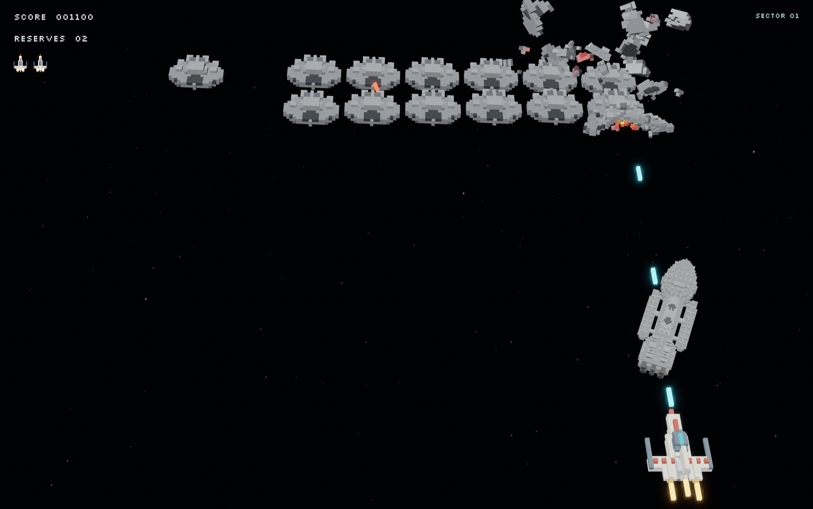
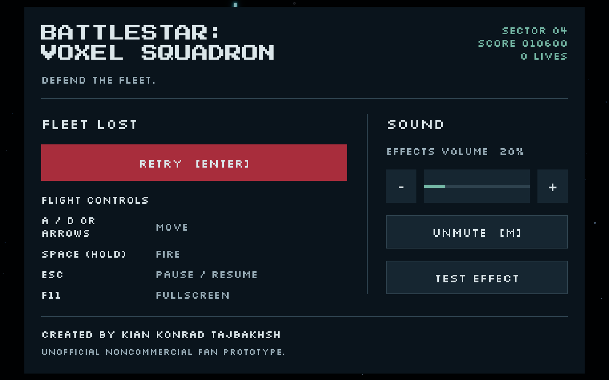
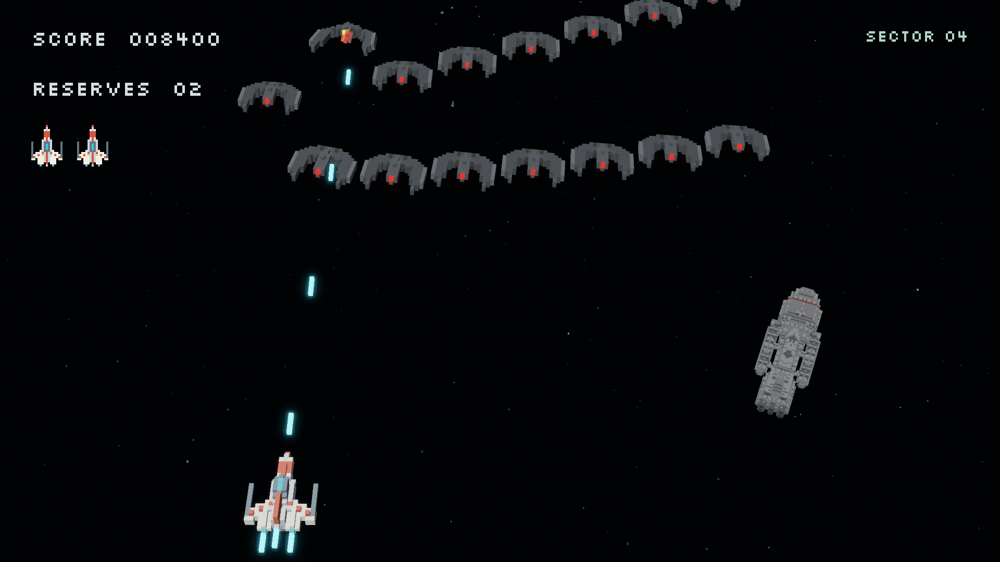
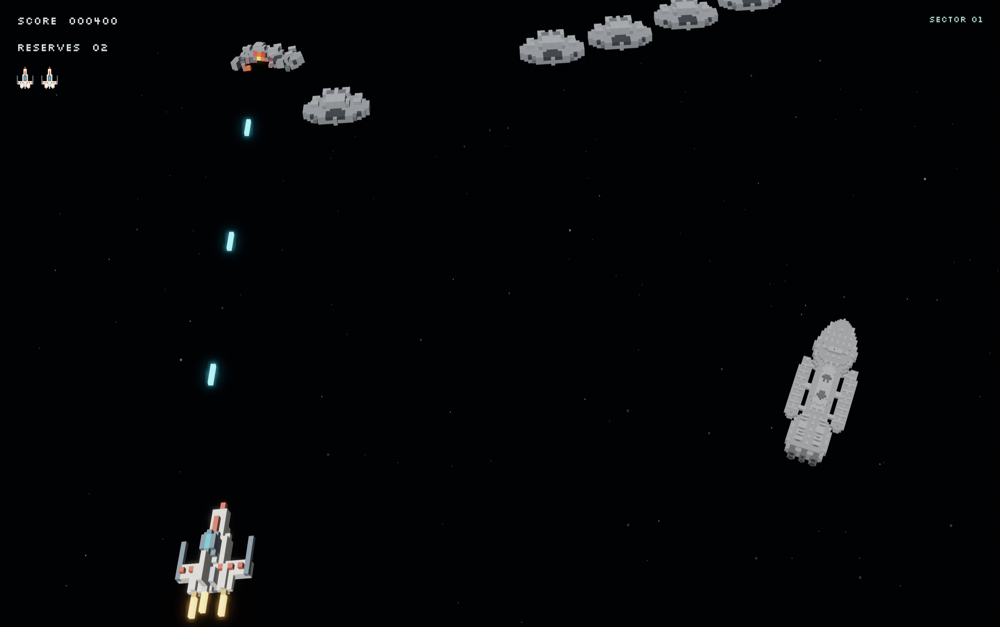

# Battlestar: Voxel Squadron

A native Rust 3D voxel arcade game by **Kian Konrad Tajbakhsh**. Fly a Viper, defend the fleet, and break Cylon formations. Ships are built from editable voxel cells, and destroyed hulls break into connected, cooling debris.



## Download and play

Get the desktop packages from [GitHub Releases](https://github.com/Kian-hdr/Battlestar_Voxel_Squadron/releases). This is an early playable fan prototype.

- **[macOS DMG, Apple Silicon](https://github.com/Kian-hdr/Battlestar_Voxel_Squadron/releases/download/v0.4.1/Battlestar_Voxel_Squadron_v0.4.1_macOS_Apple_Silicon.dmg):** open the DMG, drag `Battlestar_Voxel_Squadron.app` to Applications, then launch it.
- **[Windows ZIP, x64](https://github.com/Kian-hdr/Battlestar_Voxel_Squadron/releases/download/v0.4.1/Battlestar_Voxel_Squadron_v0.4.1_Windows_x86_64.zip):** extract the ZIP and run `Battlestar_Voxel_Squadron.exe`.
- **[Linux archive, x64](https://github.com/Kian-hdr/Battlestar_Voxel_Squadron/releases/download/v0.4.1/Battlestar_Voxel_Squadron_v0.4.1_Linux_x86_64.tar.gz):** extract the archive, install the runtime libraries listed in its README, and run `./Battlestar_Voxel_Squadron` in a graphical session with a Vulkan driver.

v0.4.1 removes Viper blinking and exhaust overlap, keeps debris until it clears the viewport, and adds soft shadow transitions with restrained projectile/exhaust glow. See [release notes](docs/Release_Notes.md).

No account, server or internet connection is needed to play. [Validation notes](docs/Release_Validation.md) state which platforms were build-tested and which were played. Windows binaries are unsigned; SmartScreen may show an unknown-publisher warning.

| Control | Action |
| --- | --- |
| Enter | Launch / restart |
| A / D or arrows | Move |
| Space, held | Fire |
| Escape | Pause / resume |
| M | Mute / unmute |
| F11 | Fullscreen / windowed |

The menu includes effects volume, mute and a sound preview. Default effects volume is 20%. Losing focus pauses combat. The game uses native display resolution and synchronized presentation, including Retina and ProMotion displays.

## The game

Three Vipers, 24 Raiders per wave, 100 points for a formation kill and 200 for a diving kill. Survive faster waves with bounded attack rates and brief respawn protection. Sectors 1–3 use the classic 1978 fleet; sector 4 onward changes the entire fleet to the reimagined 2004 era.

The fixed-step simulation handles horizontal arcade combat while ships bank and avoid each other in 3D. Friendly fire follows aligned enemies in depth so cinematic flight height does not make them unreachable. Debris comes from actual model cells, remains in connected chunks, cools in flight and deflects from other hulls.





More screenshots: [pause menu](docs/Screenshots/Pause_Menu.png), [cooling debris](docs/Screenshots/Cooling_Debris.png), [game over](docs/Screenshots/Game_Over.png). These are actual game captures from the scripted Mac validation scenario.

## Build and modify

Rust **1.99.1**, Bevy **0.17.3**, edition 2024. Install [rustup](https://rustup.rs/); the checked-in toolchain and lockfile pin the build. All game code is Rust.

```sh
cargo build --release --locked
cargo test --locked --no-default-features
cargo fmt --check
cargo clippy --locked --all-targets -- -D warnings
```

- **macOS:** install Xcode Command Line Tools; run `./script/package_mac.sh`, then open `dist/Battlestar_Voxel_Squadron.app`. Local source packages are ad-hoc signed. Developer ID signing requires your own identity through `BSVX_SIGN_IDENTITY`.
- **Windows:** install Visual Studio C++ Build Tools, Windows SDK and Rust's MSVC toolchain. Run `cargo build --release --locked`, then `target\release\battlestar_voxel.exe`.
- **Ubuntu/Debian:** install `build-essential pkg-config libasound2-dev libx11-dev libxi-dev libxrandr-dev libxcursor-dev libxkbcommon-dev libwayland-dev libvulkan1 mesa-vulkan-drivers`, build, then run `./target/release/battlestar_voxel`. Both X11 and Wayland are enabled.

Source builds include redistributable fallback sound effects. Official binaries embed the selected quieter, deeper mix. See [audio licensing and build inputs](docs/Audio_Public_Source.md). No provider API or API key is needed to build or play.

`src/simulation.rs` and `src/waves.rs` own combat; `src/voxel.rs` stores models and emits exposed voxel faces; `src/voxel_damage.rs` and `src/voxel_collision.rs` handle material breakup and contacts; rendering, input, menu and audio remain separate. Edit occupied cells and palettes to change ship models. The GPU draws exposed faces, while damage and collision operate on voxel data.

`--smoke-test` runs a silent scripted scenario, captures screenshots and checks waves, era transition, pause, restart, resizing and death. It grants temporary protection during its combat phase and does not replace human gameplay testing.

## License and fan notice

Original code is licensed under [MIT](LICENSE), allowing modification and redistribution of the original software. Fonts, audio and dependencies have separate licenses in [THIRD_PARTY_NOTICES.md](THIRD_PARTY_NOTICES.md).

**Unofficial, noncommercial fan project.** Battlestar Galactica names, spacecraft designs and related rights belong to their respective owners. This project is not affiliated with or endorsed by NBCUniversal or any franchise rights holder. No extracted show assets, recordings or official logos are bundled. MIT does not grant franchise rights. Noncommercial status and this disclaimer do not replace permission or guarantee protection from claims. See the [rights review](docs/Rights_Review.md).

The game has no analytics, telemetry service, online accounts or persistent player data. Report reproducible bugs through [repository issues](https://github.com/Kian-hdr/Battlestar_Voxel_Squadron/issues), including your OS and graphics hardware. Do not post credentials or private information.
